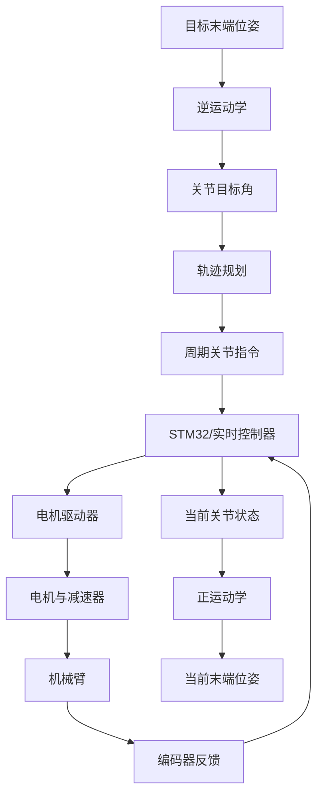

[[机械臂/机械臂索引|机械臂索引]] · [[机械臂/实操及实现效果/机械臂运动学与实物控制完整实现指南|完整实现指南总目录]] · 上一篇：[[机械臂/实操及实现效果/完整实现指南/完整实现指南-03-轨迹规划|03 轨迹规划]] · 下一篇：[[机械臂/实操及实现效果/完整实现指南/完整实现指南-05-软件模块调试与验收|05 软件模块调试与验收]]

> 这是《机械臂运动学正逆解与实物控制完整实现指南》的第 4 部分（原文第 14～19 章），正文未改动。

# 14. 实物控制系统架构

推荐使用分层架构。

## 14.1 PC/Linux/ROS 2 层

负责：

- 正运动学；
- 逆运动学；
- 轨迹规划；
- 碰撞检测；
- 工作空间判断；
- 图形界面；
- 示教与任务逻辑；
- 数据记录；
- ROS 2 节点和 MoveIt 集成。

## 14.2 STM32/实时控制器层

负责：

- 接收目标关节位置；
- 读取编码器；
- 与电机驱动器通信；
- 关节同步；
- 位置、速度或力矩闭环；
- 限位检测；
- 急停；
- 通信超时；
- 驱动器故障处理；
- 实时状态上报。

## 14.3 电机驱动器层

负责：

- 电流环；
- 速度环；
- 位置环；
- 编码器解码；
- FOC；
- 过流、过压、过温保护。

如果驱动器支持完整位置控制，STM32 主要负责：

- 给每个驱动器发送位置命令；
- 控制同步；
- 状态监控；
- 安全状态机。

如果驱动器只支持力矩控制，则 STM32 还需要实现：

- 关节位置环；
- 速度环；
- 前馈补偿；
- 更高实时性控制。

## 14.4 推荐数据流



---

# 15. 电机、编码器与关节角映射

运动学中的关节角与电机编码器值不是同一个量。

## 15.1 基本换算

设：

- 编码器读数对应电机轴角度 $\theta_{motor}$；
- 减速比为 $N$；
- 关节方向因子为 $s$；
- 零位偏移为 $q_{offset}$。

则模型关节角：

$$
q =
s\left(
\frac{\theta_{motor}}{N}
-q_{offset}
\right)
$$

若编码器直接安装在关节输出轴，则不需要除以减速比。

## 15.2 编码器计数转角度

增量编码器：

$$
\theta_{motor}
=
2\pi
\frac{count-count_0}
{CPR}
$$

如果是四倍频，需要使用实际计数分辨率。

绝对编码器：

$$
\theta_{motor}
=
2\pi
\frac{raw}
{2^n}
$$

## 15.3 反向发送目标

模型关节目标转电机目标：

$$
\theta_{motor,d}
=
N\left(
s q_d + q_{offset}
\right)
$$

再转换为驱动器位置单位。

## 15.4 回差与柔性

谐波、行星减速器和同步带都可能存在：

- 回差；
- 柔性；
- 摩擦；
- 死区；
- 负载变形。

运动学模型通常假设关节是刚性的，因此实际末端精度可能明显低于理论精度。

后续可以通过：

- 单方向接近目标；
- 回差补偿；
- 编码器安装到输出端；
- 外部视觉反馈；
- 参数辨识；
- 误差模型补偿；

来提高精度。

---

# 16. 回零与零位标定

## 16.1 为什么必须回零

增量编码器上电后通常不知道绝对位置，因此必须寻找参考点。

即使使用绝对编码器，也需要建立：

```text
编码器绝对值
    ↔
机械零位
    ↔
运动学模型零位
```

## 16.2 常见回零方式

### 限位开关回零

1. 关节低速向限位方向运动；
2. 检测到限位开关；
3. 反向退出一定距离；
4. 再以更低速度接近；
5. 记录编码器值；
6. 设置零位偏移。

### 机械硬挡块回零

通过电流或力矩上升判断到达挡块。

风险较高，应限制：

- 速度；
- 电流；
- 时间；
- 温升；
- 冲击。

### 绝对编码器标定

将机械臂摆到标准零位，记录每个关节编码器值。

### 标定销或治具

使用定位孔、定位销、水平仪、角尺等工具保证机械位置一致。

## 16.3 回零状态机

```text
IDLE
  ↓
CHECK_SAFE
  ↓
SEARCH_HOME_FAST
  ↓
BACK_OFF
  ↓
SEARCH_HOME_SLOW
  ↓
SET_ZERO
  ↓
VERIFY
  ↓
READY
```

任何阶段出现：

- 超时；
- 限位信号异常；
- 编码器不变化；
- 电流过大；
- 通信错误；

都应进入故障状态。

---

# 17. 工具坐标系与基坐标系标定

## 17.1 工具坐标系

正运动学通常计算到法兰：

$$
{}^{base}T_{flange}
$$

真正要控制的是夹爪尖端或焊枪尖端：

$$
{}^{base}T_{tool}
=
{}^{base}T_{flange}
{}^{flange}T_{tool}
$$

如果忽略工具变换，会出现固定的空间偏差。

## 17.2 TCP 标定

常见方法是多点法：

- 使用不同机械臂姿态；
- 让工具尖端始终对准同一个固定点；
- 根据多个法兰位姿求解工具尖端相对法兰的位置。

## 17.3 工具姿态标定

除了工具长度，还要确定工具轴方向。

例如夹爪的：

- 前进方向；
- 张开方向；
- 法向方向。

## 17.4 基坐标系标定

如果机械臂安装在工作台上，需要确定：

$$
{}^{world}T_{base}
$$

可通过测量多个已知点完成。

如果有相机，还需要：

$$
{}^{base}T_{camera}
$$

或者：

$$
{}^{tool}T_{camera}
$$

这属于手眼标定问题。

---

# 18. 控制周期与通信设计

## 18.1 控制周期分层

典型周期：

| 模块 | 频率示例 |
|---|---:|
| 电流环 | 10～40 kHz |
| 速度环 | 1～10 kHz |
| 位置环 | 500 Hz～2 kHz |
| STM32 关节调度 | 500 Hz～1 kHz |
| 上位机轨迹下发 | 100～500 Hz |
| 状态显示 | 10～50 Hz |

## 18.2 CAN/FDCAN 数据设计

建议每帧包含：

- 关节 ID；
- 命令类型；
- 目标位置；
- 目标速度；
- 前馈力矩；
- 时间戳或序号；
- 校验字段。

状态帧包含：

- 实际位置；
- 实际速度；
- 电流或力矩；
- 温度；
- 故障码；
- 限位状态；
- 时间戳。

## 18.3 同步问题

多关节必须尽量在同一时刻更新命令。

可以采用：

- 同步触发帧；
- 所有关节先缓存目标，再统一执行；
- 时间戳执行；
- EtherCAT 分布式时钟；
- CAN 广播同步。

## 18.4 通信超时

如果超过一定时间没有收到新指令：

- 停止更新目标；
- 减速停止；
- 保持当前位置；
- 或进入安全失能状态。

不要继续执行最后一条速度命令。

---

# 19. 安全保护设计

实物机械臂必须把安全保护放在运动学之前。

## 19.1 必备保护

- 急停；
- 硬限位；
- 软件限位；
- 最大速度限制；
- 最大加速度限制；
- 最大电流/力矩限制；
- 驱动器故障检测；
- 编码器异常检测；
- 通信超时；
- 目标跳变检测；
- 逆解失败禁止运动；
- 轨迹未验证禁止执行；
- 上电未回零禁止自动运动；
- 状态机互锁；
- 看门狗；
- 电源异常处理。

## 19.2 软件限位

命令和反馈都要检查：

$$
q_{min}\leq q_{cmd}\leq q_{max}
$$

$$
q_{min}-margin\leq q_{actual}\leq q_{max}+margin
$$

## 19.3 跟踪误差

定义：

$$
e_i=q_{cmd,i}-q_{actual,i}
$$

若持续超过阈值：

- 停止；
- 降速；
- 进入故障；
- 检查堵转、负载、驱动器或通信。

## 19.4 速度异常

根据编码器差分计算速度：

$$
\dot q_i(k)
=
\frac{q_i(k)-q_i(k-1)}{\Delta t}
$$

如果速度超过物理上限，可能是：

- 编码器跳变；
- 多圈计数溢出；
- 数据解析错误；
- 通信帧错位。

## 19.5 初次上电调试建议

- 机械臂吊起或卸载；
- 先拆掉末端工具；
- 电流限制设低；
- 速度限制设低；
- 加速度限制设低；
- 人员远离工作空间；
- 手边保持急停；
- 一次只测试一个关节；
- 禁止直接执行大角度动作。
