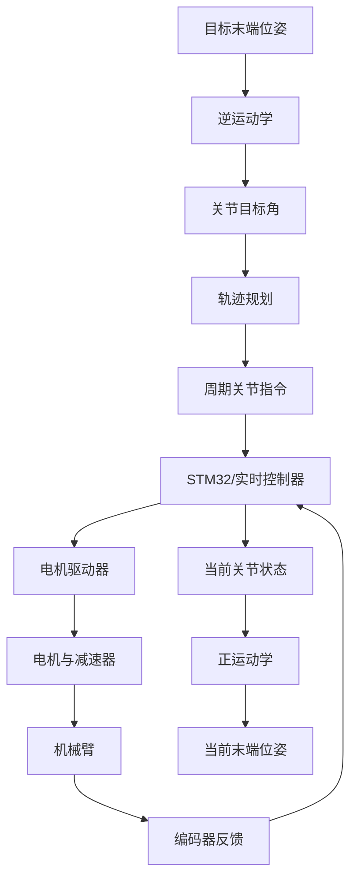

# 机械臂运动学正逆解与实物控制完整实现指南

> [!info] 本篇定位
> **实施版**：包含数据结构、伪代码、参数建议、测试用例、里程碑和常见问题排查。需要快速回顾时看 [[机械臂/基础知识/机械臂运动学与实物控制简明指南|简明指南]]；概念疑问见 [[机械臂/问答与疑问/机械臂运动学对话整理|运动学对话整理]]。
> 相关词条：[[具身智能/基础知识/具身智能新手名词表/入门必知/04-力学与运动学|力学与运动学]] · [[具身智能/基础知识/具身智能新手名词表/入门必知/05-控制与规划|控制与规划]] · [[具身智能/基础知识/具身智能新手名词表/入门必知/06-感知与传感器|感知与传感器]]
> [[机械臂/机械臂索引|返回机械臂索引]]

> 适用对象：希望从零完成串联式机械臂运动学建模、正逆解、轨迹规划，并最终在实物机械臂上实现末端位置与姿态控制的嵌入式/机器人开发者。  
> 默认场景：4～6 自由度串联机械臂，关节主要为旋转关节，电机驱动器支持位置、速度或力矩控制。  
> 推荐架构：PC/Linux/ROS 2 负责运动学与轨迹规划，STM32 或实时控制器负责电机通信、关节闭环和安全保护。

---

## 目录

1. [项目最终目标](#1-项目最终目标)
2. [先理解完整控制链](#2-先理解完整控制链)
3. [明确机械臂控制层级](#3-明确机械臂控制层级)
4. [机械参数与硬件信息收集](#4-机械参数与硬件信息收集)
5. [建立坐标系与符号规范](#5-建立坐标系与符号规范)
6. [机械臂运动学建模](#6-机械臂运动学建模)
7. [正运动学实现](#7-正运动学实现)
8. [雅可比矩阵与微分运动学](#8-雅可比矩阵与微分运动学)
9. [逆运动学实现](#9-逆运动学实现)
10. [逆解多解筛选与连续性处理](#10-逆解多解筛选与连续性处理)
11. [奇异点与不可达目标处理](#11-奇异点与不可达目标处理)
12. [关节空间轨迹规划](#12-关节空间轨迹规划)
13. [笛卡尔空间轨迹规划](#13-笛卡尔空间轨迹规划)
14. [实物控制系统架构](#14-实物控制系统架构)
15. [电机、编码器与关节角映射](#15-电机编码器与关节角映射)
16. [回零与零位标定](#16-回零与零位标定)
17. [工具坐标系与基坐标系标定](#17-工具坐标系与基坐标系标定)
18. [控制周期与通信设计](#18-控制周期与通信设计)
19. [安全保护设计](#19-安全保护设计)
20. [软件模块划分](#20-软件模块划分)
21. [仿真与实物调试流程](#21-仿真与实物调试流程)
22. [测试用例与验收标准](#22-测试用例与验收标准)
23. [推荐开发工具与技术栈](#23-推荐开发工具与技术栈)
24. [项目实施里程碑](#24-项目实施里程碑)
25. [常见问题与排查方法](#25-常见问题与排查方法)
26. [建议的最终工程结构](#26-建议的最终工程结构)
27. [结论与核心原则](#27-结论与核心原则)

---

# 1. 项目最终目标

机械臂运动学控制的最终目标不是“写出一个逆运动学函数”，而是建立一条从用户目标到机械臂实物动作的完整链路。

用户给出目标末端位姿：

$$
{}^{base}T_{tool,d}
$$

系统通过逆运动学计算出目标关节角：

$$
q_d = IK\left({}^{base}T_{tool,d}\right)
$$

再通过轨迹规划生成一系列随时间变化的关节命令：

$$
q_d(t),\quad \dot q_d(t),\quad \ddot q_d(t)
$$

最后由控制器驱动电机运动，并利用编码器反馈形成闭环。

完整目标可以概括为：

```text
目标末端位姿
    ↓
逆运动学
    ↓
目标关节角
    ↓
轨迹规划
    ↓
关节位置/速度/力矩控制
    ↓
电机与减速器
    ↓
机械臂实际运动
    ↓
编码器反馈
    ↓
当前关节角
    ↓
正运动学计算实际末端位姿
```

最终应该具备以下功能：

- 读取每个关节的实际角度；
- 计算当前末端位置与姿态；
- 输入一个目标末端位姿；
- 判断目标是否可达；
- 求出一组合理、连续且不超限的关节角；
- 规划平滑运动轨迹；
- 低速、安全地控制机械臂到达目标位置；
- 检测通信、编码器、驱动器和轨迹异常；
- 支持点到点运动和末端直线运动；
- 为后续速度控制、力控制、视觉抓取和自动规划打下基础。

---

# 2. 先理解完整控制链

运动学只负责描述机械臂“几何关系”，它本身不会让电机转动。

机械臂实物控制至少包括以下几层：

| 层级 | 功能 | 典型运行设备 |
|---|---|---|
| 任务层 | 抓取、搬运、示教、视觉目标 | PC/Linux |
| 规划层 | 目标解析、路径规划、轨迹规划 | PC/Linux/ROS 2 |
| 运动学层 | 正运动学、逆运动学、雅可比 | PC/Linux 或 MCU |
| 关节控制层 | 位置环、速度环、力矩环 | 驱动器/STM32 |
| 硬件执行层 | 电机、编码器、减速器、机械结构 | 实物机械臂 |
| 安全层 | 急停、限位、过流、超速、通信超时 | MCU/驱动器/硬件 |

运动学控制处于中间位置：

- 上游接收末端目标；
- 下游输出关节目标；
- 上游不关心电机细节；
- 下游不负责理解末端坐标。

这种分层非常重要，因为它决定了后续软件架构是否清晰。

---

# 3. 明确机械臂控制层级

在项目开始前，先确定你要实现哪一级控制。

## 3.1 关节空间位置控制

用户直接给出目标关节角：

$$
q_d =
\begin{bmatrix}
q_{1,d} & q_{2,d} & \cdots & q_{n,d}
\end{bmatrix}^T
$$

系统让每个关节运动到指定角度。

这是所有机械臂项目的第一步。

实现目标：

- 每个关节都能独立运动；
- 多关节能同步运动；
- 实际角度能跟踪目标角度；
- 运动过程不抖动、不冲击；
- 不触发软限位和硬限位。

## 3.2 末端点位控制

用户给出目标位置和姿态：

$$
p_d = [x_d, y_d, z_d]^T
$$

$$
R_d \in SO(3)
$$

组合为齐次变换矩阵：

$$
T_d =
\begin{bmatrix}
R_d & p_d\\
0 & 1
\end{bmatrix}
$$

系统通过逆运动学计算目标关节角，再执行关节空间轨迹。

适合：

- 从当前位置运动到某个抓取点；
- 点到点搬运；
- 示教点复现；
- 简单自动化任务。

## 3.3 笛卡尔空间轨迹控制

要求机械臂末端沿指定路径运动，例如：

- 直线；
- 圆弧；
- 曲线；
- 保持某个姿态移动；
- 边移动边旋转。

此时不能只在起点和终点进行逆运动学，而要对轨迹上的多个中间位姿进行逆解。

## 3.4 推荐实施顺序

```text
单电机开环测试
    ↓
单关节闭环控制
    ↓
多关节同步控制
    ↓
正运动学
    ↓
逆运动学
    ↓
关节空间点到点运动
    ↓
笛卡尔直线运动
    ↓
连续轨迹与高级控制
```

不要跳过前面的步骤直接做末端控制，否则一旦出错，很难判断问题来自：

- 电机；
- 编码器；
- 坐标系；
- 零位；
- 运动学；
- 轨迹规划；
- 通信；
- 控制器。

---

# 4. 机械参数与硬件信息收集

在写运动学程序之前，必须先建立机械臂参数表。

## 4.1 机械结构参数

需要记录：

- 机械臂自由度；
- 每个关节是旋转关节还是移动关节；
- 每个关节轴的空间方向；
- 连杆长度；
- 关节轴之间的偏距；
- 末端法兰长度；
- 夹爪或工具长度；
- 每个关节的机械零位；
- 各关节最大和最小角度；
- 自碰撞区域；
- 安装方向。

建议制作一张机械臂尺寸图，并明确所有尺寸从哪个坐标原点开始测量。

## 4.2 电机与减速器参数

每个关节需要记录：

| 参数 | 示例 |
|---|---|
| 电机类型 | 伺服、无刷、步进 |
| 编码器类型 | 增量式、单圈绝对值、多圈绝对值 |
| 编码器分辨率 | 17 bit、20 bit、4096 PPR |
| 减速器类型 | 谐波、行星、摆线 |
| 减速比 | 50:1、80:1、100:1 |
| 电机正方向 | 顺时针或逆时针 |
| 关节正方向 | 根据右手定则定义 |
| 驱动模式 | 位置、速度、力矩 |
| 通信接口 | CAN、FDCAN、EtherCAT、RS485 |
| 最大速度 | rad/s 或 rpm |
| 最大加速度 | rad/s² |
| 最大电流/力矩 | 安全限制 |

## 4.3 坐标与单位规范

必须统一：

- 角度：内部全部使用弧度；
- 长度：推荐使用米；
- 时间：秒；
- 速度：rad/s、m/s；
- 加速度：rad/s²、m/s²；
- 力矩：N·m；
- 矩阵：统一使用列向量还是行向量；
- 旋转：统一主动旋转或被动旋转约定；
- 坐标变换：明确 $ {}^AT_B $ 表示 B 坐标系相对于 A 坐标系。

推荐代码内部全部采用 SI 单位，只在界面显示时转换为度、毫米等。

---

# 5. 建立坐标系与符号规范

## 5.1 常见坐标系

机械臂通常包含：

```text
world：世界坐标系
base：机械臂基座坐标系
joint_i：第 i 个关节坐标系
flange：末端法兰坐标系
tool：工具中心点坐标系 TCP
camera：相机坐标系
object：目标物体坐标系
```

常见变换关系：

$$
{}^{world}T_{tool}
=
{}^{world}T_{base}
{}^{base}T_{flange}
{}^{flange}T_{tool}
$$

其中：

- $ {}^{world}T_{base} $：机械臂基座在世界中的位姿；
- $ {}^{base}T_{flange} $：运动学计算得到的法兰位姿；
- $ {}^{flange}T_{tool} $：工具相对法兰的固定变换。

## 5.2 右手定则

每个旋转关节的正方向必须按照右手定则定义：

- 右手大拇指指向关节轴正方向；
- 四指弯曲方向为关节正旋转方向。

实物电机正方向可能和运动学模型正方向相反，因此要设置方向因子：

$$
s_i \in \{-1,1\}
$$

## 5.3 坐标系错误的典型表现

- 机械臂仿真方向和实物相反；
- 关节 2 增大时，末端向下而不是向上；
- 正运动学位置大致正确，但姿态完全不对；
- 逆解在某些象限突然跳变；
- 末端直线在实物上变成弧线；
- 工具末端和法兰位置偏差固定。

---

# 6. 机械臂运动学建模

常见建模方法有：

1. 标准 DH 参数；
2. 改进 DH 参数；
3. POE（Product of Exponentials，指数积）；
4. URDF 关节树模型。

初次开发推荐：

- 理论推导和手写算法：使用标准 DH 或改进 DH；
- ROS 2 和工程集成：使用 URDF；
- 高级机器人算法：可进一步学习 POE。

## 6.1 标准 DH 参数

每个关节用四个参数描述：

| 参数 | 含义 |
|---|---|
| $a_i$ | 连杆长度 |
| $\alpha_i$ | 连杆扭转角 |
| $d_i$ | 连杆偏距 |
| $\theta_i$ | 关节角 |

标准 DH 变换矩阵：

$$
{}^{i-1}T_i =
\begin{bmatrix}
c_{\theta_i} &
-s_{\theta_i}c_{\alpha_i} &
s_{\theta_i}s_{\alpha_i} &
a_i c_{\theta_i}\\
s_{\theta_i} &
c_{\theta_i}c_{\alpha_i} &
-c_{\theta_i}s_{\alpha_i} &
a_i s_{\theta_i}\\
0 &
s_{\alpha_i} &
c_{\alpha_i} &
d_i\\
0 & 0 & 0 & 1
\end{bmatrix}
$$

其中：

$$
c_{\theta_i} = \cos\theta_i,\quad
s_{\theta_i} = \sin\theta_i
$$

对于旋转关节：

$$
\theta_i = q_i + \theta_{offset,i}
$$

对于移动关节：

$$
d_i = q_i + d_{offset,i}
$$

## 6.2 DH 建模步骤

1. 确定每个关节轴；
2. 将 $z_i$ 轴沿关节轴方向设置；
3. 确定相邻关节轴的公法线；
4. 将 $x_i$ 轴沿公法线设置；
5. 根据右手定则确定 $y_i$；
6. 填写 $a_i,\alpha_i,d_i,\theta_i$；
7. 绘制完整坐标系图；
8. 将零位姿态代入验证。

## 6.3 DH 参数表模板

| 关节 i | $a_i$ | $\alpha_i$ | $d_i$ | $\theta_i$ | 角度范围 |
|---|---:|---:|---:|---:|---:|
| 1 |  |  |  | $q_1+\theta_{01}$ |  |
| 2 |  |  |  | $q_2+\theta_{02}$ |  |
| 3 |  |  |  | $q_3+\theta_{03}$ |  |
| 4 |  |  |  | $q_4+\theta_{04}$ |  |
| 5 |  |  |  | $q_5+\theta_{05}$ |  |
| 6 |  |  |  | $q_6+\theta_{06}$ |  |

## 6.4 URDF 建模

URDF 用于描述：

- 连杆；
- 关节；
- 关节轴；
- 质量；
- 惯量；
- 碰撞模型；
- 可视化模型；
- 关节限位。

URDF 中最重要的是：

- `origin xyz/rpy`；
- `axis xyz`；
- `limit lower/upper/velocity/effort`；
- 父子 link 关系。

推荐先用简单几何体建立 URDF，验证运动方向后再加入 STL/DAE 模型。

---

# 7. 正运动学实现

正运动学输入关节变量 $q$，输出末端位姿：

$$
{}^0T_n = f(q)
$$

对于串联机械臂：

$$
{}^0T_n =
{}^0T_1
{}^1T_2
\cdots
{}^{n-1}T_n
$$

## 7.1 输出内容

齐次变换矩阵：

$$
T =
\begin{bmatrix}
R & p\\
0 & 1
\end{bmatrix}
$$

其中：

$$
p=
\begin{bmatrix}
x\\y\\z
\end{bmatrix}
$$

$$
R=
\begin{bmatrix}
r_{11}&r_{12}&r_{13}\\
r_{21}&r_{22}&r_{23}\\
r_{31}&r_{32}&r_{33}
\end{bmatrix}
$$

## 7.2 推荐数据结构

```cpp
struct JointVector {
    std::array<double, 6> q;
};

struct Pose {
    Eigen::Vector3d position;
    Eigen::Quaterniond orientation;
};

Eigen::Matrix4d forwardKinematics(const JointVector& joints);
```

内部计算时建议使用旋转矩阵，模块接口和轨迹插值时可使用四元数。

## 7.3 需要同时保存的中间结果

为了计算雅可比和调试，正运动学函数最好返回每一级变换：

$$
{}^0T_1,\ {}^0T_2,\ \ldots,\ {}^0T_n
$$

因为雅可比需要每个关节轴 $z_i$ 和关节原点 $p_i$。

推荐接口：

```cpp
struct KinematicsResult {
    std::vector<Eigen::Matrix4d> transforms;
    Eigen::Matrix4d end_pose;
};

KinematicsResult forwardAll(const JointVector& joints);
```

## 7.4 正运动学验证方法

### 方法一：特殊姿态验证

选择容易手工计算的姿态：

- 全部关节为 0；
- 单个关节为 90°；
- 两个关节构成直角；
- 机械臂完全展开；
- 机械臂垂直向上。

### 方法二：逐关节验证

只改变一个关节，检查：

- 是否绕正确轴旋转；
- 旋转方向是否正确；
- 其他关节坐标系是否跟随；
- 末端路径是否符合机械结构。

### 方法三：与其他工具交叉验证

可使用：

- MATLAB Robotics Toolbox；
- Python Robotics Toolbox；
- ROS 2 TF；
- MoveIt；
- Pinocchio；
- KDL；
- CAD 软件测量。

### 方法四：随机测试

随机生成大量关节角，比较两个独立实现的结果：

$$
\|p_1-p_2\| < \epsilon_p
$$

$$
\theta(R_1^TR_2) < \epsilon_R
$$

## 7.5 正运动学实物验证

1. 将机械臂移动到已知关节角；
2. 读取编码器；
3. 转换为模型关节角；
4. 计算末端位置；
5. 使用卷尺、激光测距、标定板或视觉测量；
6. 比较理论与实际结果。

误差来源包括：

- 连杆尺寸测量不准；
- 编码器零位偏差；
- 减速器回差；
- 机械装配误差；
- 工具长度误差；
- 关节轴不完全相交；
- 连杆发生弹性变形。

---

# 8. 雅可比矩阵与微分运动学

雅可比矩阵建立关节速度与末端速度之间的关系：

$$
\dot x = J(q)\dot q
$$

对于 6 自由度末端速度：

$$
\dot x =
\begin{bmatrix}
v\\
\omega
\end{bmatrix}
$$

其中：

- $v$：末端线速度；
- $\omega$：末端角速度。

## 8.1 旋转关节雅可比列

对于第 $i$ 个旋转关节：

$$
J_{v_i}=z_{i-1}\times(p_n-p_{i-1})
$$

$$
J_{\omega_i}=z_{i-1}
$$

因此：

$$
J_i=
\begin{bmatrix}
z_{i-1}\times(p_n-p_{i-1})\\
z_{i-1}
\end{bmatrix}
$$

## 8.2 移动关节雅可比列

对于移动关节：

$$
J_{v_i}=z_{i-1}
$$

$$
J_{\omega_i}=0
$$

## 8.3 雅可比用途

- 数值逆运动学；
- 末端速度控制；
- 奇异点检测；
- 关节速度限制映射；
- 力与力矩映射；
- 阻抗控制；
- 可操作度分析。

## 8.4 雅可比数值验证

使用有限差分：

$$
J_i \approx
\frac{x(q+\Delta q_i)-x(q)}{\Delta q_i}
$$

位置部分比较容易验证。

姿态部分可以使用旋转误差向量：

$$
R_{err}=R(q)^T R(q+\Delta q_i)
$$

再将其转换为轴角小量。

推荐设置：

$$
\Delta q_i = 10^{-6} \sim 10^{-5}\ \text{rad}
$$

如果数值雅可比与解析雅可比偏差很大，应检查：

- 使用了 $z_i$ 还是 $z_{i-1}$；
- 关节原点是否取错；
- 坐标是否全部表达在同一坐标系；
- 叉乘顺序是否相反；
- 正运动学中间矩阵是否正确。

---

# 9. 逆运动学实现

逆运动学输入目标位姿，输出关节角：

$$
q = IK(T_d)
$$

它可能存在：

- 无解；
- 唯一解；
- 多解；
- 无限多解；
- 奇异解。

因此，逆运动学函数不应只返回一个数组，而应包含状态信息。

推荐接口：

```cpp
enum class IKStatus {
    Success,
    Unreachable,
    Singular,
    JointLimitViolation,
    MaxIterationReached,
    InvalidTarget
};

struct IKSolution {
    IKStatus status;
    JointVector joints;
    double position_error;
    double orientation_error;
    int iterations;
};
```

## 9.1 解析逆运动学

适合结构规则的机械臂，例如：

- 前三轴负责腕心位置；
- 后三轴构成球形腕；
- 关节轴有明显几何关系。

典型步骤：

### 第一步：求腕心位置

已知工具或法兰目标位姿：

$$
T_d=
\begin{bmatrix}
R_d&p_d\\
0&1
\end{bmatrix}
$$

若末端最后一段沿末端 $z$ 轴长度为 $d_6$，则腕心：

$$
p_w = p_d - d_6 R_d
\begin{bmatrix}
0\\0\\1
\end{bmatrix}
$$

### 第二步：求前三个关节

利用平面几何、余弦定理和反正切函数求：

$$
q_1,q_2,q_3
$$

例如：

$$
q_1 = \operatorname{atan2}(y_w,x_w)
$$

其余角度根据连杆长度和腕心位置求解。

### 第三步：求后三个关节

先计算前三轴旋转：

$$
R_0^3(q_1,q_2,q_3)
$$

再得到腕部旋转：

$$
R_3^6=(R_0^3)^T R_d
$$

最后从 $R_3^6$ 中提取：

$$
q_4,q_5,q_6
$$

### 解析法优点

- 速度快；
- 结果精确；
- 可得到全部解；
- 适合高频实时控制。

### 解析法缺点

- 推导量大；
- 对机械结构依赖强；
- 结构稍有改变就要重新推导；
- 奇异点分支处理复杂。

## 9.2 数值逆运动学

数值法适用于任意串联机械臂。

基本目标是不断减小当前位姿和目标位姿的误差。

### 位置误差

$$
e_p=p_d-p(q)
$$

### 姿态误差

可以用旋转矩阵误差：

$$
R_e = R(q)^T R_d
$$

再转换为旋转向量：

$$
e_R = \operatorname{Log}(R_e)
$$

组合误差：

$$
e=
\begin{bmatrix}
w_p e_p\\
w_R e_R
\end{bmatrix}
$$

其中 $w_p,w_R$ 是位置与姿态权重。

### 雅可比伪逆法

$$
\Delta q=J^\dagger e
$$

$$
q_{k+1}=q_k+\alpha\Delta q
$$

### 阻尼最小二乘法

推荐使用：

$$
\Delta q=
J^T(JJ^T+\lambda^2I)^{-1}e
$$

或者：

$$
\Delta q=
(J^TJ+\lambda^2I)^{-1}J^Te
$$

优点：

- 奇异点附近更稳定；
- 不容易出现巨大关节变化；
- 实现相对简单。

### 数值逆解伪代码

```cpp
IKSolution inverseKinematics(
    const Pose& target,
    const JointVector& initial_guess)
{
    JointVector q = initial_guess;

    for (int iter = 0; iter < max_iterations; ++iter) {
        Pose current = forwardKinematics(q);

        Vector6d error = poseError(current, target);

        if (positionError(error) < pos_tolerance &&
            orientationError(error) < rot_tolerance) {
            return success(q, iter);
        }

        Matrix6Xd J = computeJacobian(q);

        MatrixXd A = J * J.transpose()
                   + lambda * lambda * Identity6();

        VectorXd dq = J.transpose() * A.ldlt().solve(error);

        limitStep(dq, max_joint_step);
        q += alpha * dq;

        applyJointLimitProjection(q);
    }

    return failure(IKStatus::MaxIterationReached);
}
```

## 9.3 数值逆解参数建议

| 参数 | 初始建议 |
|---|---:|
| 最大迭代次数 | 50～200 |
| 位置误差阈值 | 0.1～1 mm |
| 姿态误差阈值 | 0.05～0.5° |
| 阻尼系数 $\lambda$ | 0.001～0.1 |
| 单次最大关节步长 | 0.5～5° |
| 步长系数 $\alpha$ | 0.1～1.0 |
| 初始值 | 当前实际关节角 |

阻尼系数不一定固定。接近奇异点时可以增大，远离奇异点时减小。

---

# 10. 逆解多解筛选与连续性处理

解析逆解经常出现多组解，例如：

- 左肩/右肩；
- 肘上/肘下；
- 翻腕/不翻腕。

不能直接选择第一组结果。

## 10.1 关节限位过滤

先删除所有超出限位的解：

$$
q_{i,min}\leq q_i\leq q_{i,max}
$$

注意周期关节的等价角：

$$
q_i,\quad q_i+2\pi,\quad q_i-2\pi
$$

应选择在限位内且最接近当前角度的形式。

## 10.2 与当前姿态的距离

最常见选择原则：

$$
q^\ast =
\arg\min_{q_k}
\sum_i w_i \left(q_{k,i}-q_{current,i}\right)^2
$$

其中 $w_i$ 可用于提高大关节或危险关节的权重。

## 10.3 避免靠近限位

可增加限位惩罚：

$$
C_{limit}(q)=
\sum_i
\frac{1}
{(q_i-q_{i,min})(q_{i,max}-q_i)}
$$

最终代价：

$$
C(q)=
w_d C_{distance}
+w_l C_{limit}
+w_s C_{singularity}
$$

## 10.4 保持解分支连续

在连续轨迹中，每个新目标位姿都应使用上一时刻的逆解作为初始值：

```text
q(k-1)
   ↓
作为初值求解 T(k)
   ↓
得到 q(k)
```

这样可以减少：

- 跳解；
- 翻腕；
- 肘部突然切换；
- 关节绕一整圈。

## 10.5 跳变检测

对每个控制周期检查：

$$
|q_i(k)-q_i(k-1)| < \Delta q_{max,i}
$$

如果超过阈值：

- 拒绝执行；
- 降低插值步长；
- 重新选择逆解；
- 重新规划整段轨迹。

---

# 11. 奇异点与不可达目标处理

## 11.1 什么是奇异点

当雅可比矩阵秩下降时，机械臂处于奇异状态。

表现为：

- 某个方向末端无法运动；
- 很小的末端速度需要很大的关节速度；
- 数值逆解震荡；
- 关节速度突然增大；
- 多个关节速度互相抵消。

## 11.2 常见奇异状态

- 手臂完全伸直；
- 肘部完全折叠；
- 腕部两个轴重合；
- 某些关节轴变为共线。

## 11.3 奇异性指标

可以使用最小奇异值：

$$
\sigma_{min}(J)
$$

当其接近 0 时，机械臂接近奇异点。

也可使用可操作度：

$$
w(q)=\sqrt{\det(JJ^T)}
$$

当 $w(q)$ 趋近 0，说明接近奇异状态。

## 11.4 处理方式

- 使用阻尼最小二乘；
- 限制关节最大速度；
- 降低笛卡尔速度；
- 绕开奇异区域；
- 重新选择逆解分支；
- 对姿态要求进行适当放宽；
- 使用零空间优化远离奇异点。

## 11.5 不可达目标

目标不可达可能来自：

- 超出最大工作半径；
- 进入基座内部不可达区域；
- 姿态要求使关节超限；
- 工具过长；
- 障碍物或自碰撞；
- 数值算法未收敛。

处理流程：

```text
输入目标
  ↓
检查数值合法性
  ↓
粗略工作空间检查
  ↓
逆运动学
  ↓
关节限位检查
  ↓
奇异性检查
  ↓
轨迹可行性检查
  ↓
允许执行
```

逆解失败时必须返回错误，不得沿用上一次目标继续运行。

---

# 12. 关节空间轨迹规划

逆运动学只产生终点关节角，不能直接一步发送给电机。

需要从当前关节角 $q_0$ 平滑过渡到目标角 $q_f$。

## 12.1 三次多项式

设：

$$
q(t)=a_0+a_1t+a_2t^2+a_3t^3
$$

可以满足：

- 起点位置；
- 终点位置；
- 起点速度；
- 终点速度。

适合简单点到点运动。

## 12.2 五次多项式

设：

$$
q(t)=
a_0+a_1t+a_2t^2+a_3t^3+a_4t^4+a_5t^5
$$

可同时满足：

- 起点位置、速度、加速度；
- 终点位置、速度、加速度。

优点：

- 速度连续；
- 加速度连续；
- 机械冲击较小；
- 易于实现。

## 12.3 梯形速度规划

运动分为：

1. 加速；
2. 匀速；
3. 减速。

优点：

- 工程上常用；
- 计算简单；
- 便于设置最大速度和加速度。

缺点：

- 加速度存在突变；
- 高精度机械臂可能有冲击。

## 12.4 S 曲线规划

通过限制加加速度（jerk）实现更平滑运动。

适合：

- 高速机械臂；
- 高负载机械臂；
- 对振动敏感的系统；
- 精密轨迹。

## 12.5 多关节同步

不同关节移动距离不同，必须让所有关节同时到达终点。

做法：

1. 计算每个关节最短运动时间；
2. 取最大值作为整段轨迹时间；
3. 所有关节使用统一时间；
4. 各关节分别计算插值系数。

## 12.6 轨迹约束检查

每个采样点检查：

$$
q_{min}\leq q(t)\leq q_{max}
$$

$$
|\dot q(t)|\leq \dot q_{max}
$$

$$
|\ddot q(t)|\leq \ddot q_{max}
$$

必要时还要检查：

$$
|\dddot q(t)|\leq j_{max}
$$

---

# 13. 笛卡尔空间轨迹规划

关节空间插值不能保证末端走直线。

如果需要末端直线运动，应在笛卡尔空间插值。

## 13.1 位置插值

$$
p(t)=p_0+s(t)(p_f-p_0)
$$

其中 $s(t)$ 从 0 平滑变化到 1。

## 13.2 姿态插值

不建议直接对欧拉角线性插值，因为容易出现：

- 万向节锁；
- 旋转路径不连续；
- 角度跳变；
- 非最短旋转。

推荐使用单位四元数球面线性插值 SLERP：

$$
Q(t)=\operatorname{SLERP}(Q_0,Q_f,s(t))
$$

## 13.3 离散插值流程

```text
给定起点位姿 T0 和终点位姿 Tf
    ↓
根据速度和距离确定总时间
    ↓
按控制周期生成 s(t)
    ↓
插值位置 p(t)
    ↓
SLERP 插值姿态 Q(t)
    ↓
组合为目标位姿 T(t)
    ↓
逐点求逆运动学
    ↓
检查关节限位和连续性
    ↓
生成关节轨迹 q(t)
```

## 13.4 先离线规划再执行

初期建议：

- 先计算整条轨迹；
- 确认每个点都有逆解；
- 确认关节不超限；
- 确认无跳变；
- 确认速度和加速度合理；
- 再发送给实物。

不要一边求解一边盲目执行，因为中途可能突然无解。

## 13.5 轨迹采样频率

常见建议：

- 上位机轨迹规划：50～250 Hz；
- 关节指令发送：100～1000 Hz；
- 电机驱动器内部控制：1～20 kHz；
- 电流环：通常最高；
- 位置环：通常较低。

具体取决于：

- 总线带宽；
- 电机驱动器能力；
- 主控性能；
- 机械臂速度；
- 对轨迹平滑度的要求。

---

# 14. 实物控制系统架构

推荐使用分层架构。

## 14.1 PC/Linux/ROS 2 层

负责：

- 正运动学；
- 逆运动学；
- 轨迹规划；
- 碰撞检测；
- 工作空间判断；
- 图形界面；
- 示教与任务逻辑；
- 数据记录；
- ROS 2 节点和 MoveIt 集成。

## 14.2 STM32/实时控制器层

负责：

- 接收目标关节位置；
- 读取编码器；
- 与电机驱动器通信；
- 关节同步；
- 位置、速度或力矩闭环；
- 限位检测；
- 急停；
- 通信超时；
- 驱动器故障处理；
- 实时状态上报。

## 14.3 电机驱动器层

负责：

- 电流环；
- 速度环；
- 位置环；
- 编码器解码；
- FOC；
- 过流、过压、过温保护。

如果驱动器支持完整位置控制，STM32 主要负责：

- 给每个驱动器发送位置命令；
- 控制同步；
- 状态监控；
- 安全状态机。

如果驱动器只支持力矩控制，则 STM32 还需要实现：

- 关节位置环；
- 速度环；
- 前馈补偿；
- 更高实时性控制。

## 14.4 推荐数据流



---

# 15. 电机、编码器与关节角映射

运动学中的关节角与电机编码器值不是同一个量。

## 15.1 基本换算

设：

- 编码器读数对应电机轴角度 $\theta_{motor}$；
- 减速比为 $N$；
- 关节方向因子为 $s$；
- 零位偏移为 $q_{offset}$。

则模型关节角：

$$
q =
s\left(
\frac{\theta_{motor}}{N}
-q_{offset}
\right)
$$

若编码器直接安装在关节输出轴，则不需要除以减速比。

## 15.2 编码器计数转角度

增量编码器：

$$
\theta_{motor}
=
2\pi
\frac{count-count_0}
{CPR}
$$

如果是四倍频，需要使用实际计数分辨率。

绝对编码器：

$$
\theta_{motor}
=
2\pi
\frac{raw}
{2^n}
$$

## 15.3 反向发送目标

模型关节目标转电机目标：

$$
\theta_{motor,d}
=
N\left(
s q_d + q_{offset}
\right)
$$

再转换为驱动器位置单位。

## 15.4 回差与柔性

谐波、行星减速器和同步带都可能存在：

- 回差；
- 柔性；
- 摩擦；
- 死区；
- 负载变形。

运动学模型通常假设关节是刚性的，因此实际末端精度可能明显低于理论精度。

后续可以通过：

- 单方向接近目标；
- 回差补偿；
- 编码器安装到输出端；
- 外部视觉反馈；
- 参数辨识；
- 误差模型补偿；

来提高精度。

---

# 16. 回零与零位标定

## 16.1 为什么必须回零

增量编码器上电后通常不知道绝对位置，因此必须寻找参考点。

即使使用绝对编码器，也需要建立：

```text
编码器绝对值
    ↔
机械零位
    ↔
运动学模型零位
```

## 16.2 常见回零方式

### 限位开关回零

1. 关节低速向限位方向运动；
2. 检测到限位开关；
3. 反向退出一定距离；
4. 再以更低速度接近；
5. 记录编码器值；
6. 设置零位偏移。

### 机械硬挡块回零

通过电流或力矩上升判断到达挡块。

风险较高，应限制：

- 速度；
- 电流；
- 时间；
- 温升；
- 冲击。

### 绝对编码器标定

将机械臂摆到标准零位，记录每个关节编码器值。

### 标定销或治具

使用定位孔、定位销、水平仪、角尺等工具保证机械位置一致。

## 16.3 回零状态机

```text
IDLE
  ↓
CHECK_SAFE
  ↓
SEARCH_HOME_FAST
  ↓
BACK_OFF
  ↓
SEARCH_HOME_SLOW
  ↓
SET_ZERO
  ↓
VERIFY
  ↓
READY
```

任何阶段出现：

- 超时；
- 限位信号异常；
- 编码器不变化；
- 电流过大；
- 通信错误；

都应进入故障状态。

---

# 17. 工具坐标系与基坐标系标定

## 17.1 工具坐标系

正运动学通常计算到法兰：

$$
{}^{base}T_{flange}
$$

真正要控制的是夹爪尖端或焊枪尖端：

$$
{}^{base}T_{tool}
=
{}^{base}T_{flange}
{}^{flange}T_{tool}
$$

如果忽略工具变换，会出现固定的空间偏差。

## 17.2 TCP 标定

常见方法是多点法：

- 使用不同机械臂姿态；
- 让工具尖端始终对准同一个固定点；
- 根据多个法兰位姿求解工具尖端相对法兰的位置。

## 17.3 工具姿态标定

除了工具长度，还要确定工具轴方向。

例如夹爪的：

- 前进方向；
- 张开方向；
- 法向方向。

## 17.4 基坐标系标定

如果机械臂安装在工作台上，需要确定：

$$
{}^{world}T_{base}
$$

可通过测量多个已知点完成。

如果有相机，还需要：

$$
{}^{base}T_{camera}
$$

或者：

$$
{}^{tool}T_{camera}
$$

这属于手眼标定问题。

---

# 18. 控制周期与通信设计

## 18.1 控制周期分层

典型周期：

| 模块 | 频率示例 |
|---|---:|
| 电流环 | 10～40 kHz |
| 速度环 | 1～10 kHz |
| 位置环 | 500 Hz～2 kHz |
| STM32 关节调度 | 500 Hz～1 kHz |
| 上位机轨迹下发 | 100～500 Hz |
| 状态显示 | 10～50 Hz |

## 18.2 CAN/FDCAN 数据设计

建议每帧包含：

- 关节 ID；
- 命令类型；
- 目标位置；
- 目标速度；
- 前馈力矩；
- 时间戳或序号；
- 校验字段。

状态帧包含：

- 实际位置；
- 实际速度；
- 电流或力矩；
- 温度；
- 故障码；
- 限位状态；
- 时间戳。

## 18.3 同步问题

多关节必须尽量在同一时刻更新命令。

可以采用：

- 同步触发帧；
- 所有关节先缓存目标，再统一执行；
- 时间戳执行；
- EtherCAT 分布式时钟；
- CAN 广播同步。

## 18.4 通信超时

如果超过一定时间没有收到新指令：

- 停止更新目标；
- 减速停止；
- 保持当前位置；
- 或进入安全失能状态。

不要继续执行最后一条速度命令。

---

# 19. 安全保护设计

实物机械臂必须把安全保护放在运动学之前。

## 19.1 必备保护

- 急停；
- 硬限位；
- 软件限位；
- 最大速度限制；
- 最大加速度限制；
- 最大电流/力矩限制；
- 驱动器故障检测；
- 编码器异常检测；
- 通信超时；
- 目标跳变检测；
- 逆解失败禁止运动；
- 轨迹未验证禁止执行；
- 上电未回零禁止自动运动；
- 状态机互锁；
- 看门狗；
- 电源异常处理。

## 19.2 软件限位

命令和反馈都要检查：

$$
q_{min}\leq q_{cmd}\leq q_{max}
$$

$$
q_{min}-margin\leq q_{actual}\leq q_{max}+margin
$$

## 19.3 跟踪误差

定义：

$$
e_i=q_{cmd,i}-q_{actual,i}
$$

若持续超过阈值：

- 停止；
- 降速；
- 进入故障；
- 检查堵转、负载、驱动器或通信。

## 19.4 速度异常

根据编码器差分计算速度：

$$
\dot q_i(k)
=
\frac{q_i(k)-q_i(k-1)}{\Delta t}
$$

如果速度超过物理上限，可能是：

- 编码器跳变；
- 多圈计数溢出；
- 数据解析错误；
- 通信帧错位。

## 19.5 初次上电调试建议

- 机械臂吊起或卸载；
- 先拆掉末端工具；
- 电流限制设低；
- 速度限制设低；
- 加速度限制设低；
- 人员远离工作空间；
- 手边保持急停；
- 一次只测试一个关节；
- 禁止直接执行大角度动作。

---

# 20. 软件模块划分

推荐将软件拆成以下层。

## 20.1 robot_model

负责：

- 机械参数；
- DH 参数；
- URDF 参数；
- 关节限位；
- 坐标变换；
- 正运动学；
- 雅可比；
- 逆运动学。

## 20.2 trajectory

负责：

- 三次/五次插值；
- 梯形速度；
- S 曲线；
- 关节同步；
- 直线插值；
- 姿态 SLERP；
- 速度与加速度约束。

## 20.3 hardware

负责：

- CAN/FDCAN；
- EtherCAT；
- RS485；
- 编码器；
- 电机驱动器；
- 数字输入输出；
- 急停和限位。

## 20.4 controller

负责：

- 关节位置控制；
- 速度控制；
- 力矩控制；
- 状态机；
- 错误处理；
- 安全监控；
- 命令调度。

## 20.5 application

负责：

- 点到点运动；
- 直线运动；
- 回零；
- 示教；
- 抓取；
- 任务队列；
- GUI；
- ROS 2 接口。

## 20.6 推荐接口

```cpp
class RobotModel {
public:
    Pose forwardKinematics(const JointVector& q) const;

    Eigen::MatrixXd jacobian(const JointVector& q) const;

    IKSolution inverseKinematics(
        const Pose& target,
        const JointVector& initial_guess) const;

    bool withinJointLimits(const JointVector& q) const;
};
```

```cpp
class TrajectoryPlanner {
public:
    JointTrajectory planJointMove(
        const JointVector& start,
        const JointVector& target,
        const MotionLimits& limits);

    CartesianTrajectory planLinearMove(
        const Pose& start,
        const Pose& target,
        const CartesianLimits& limits);
};
```

```cpp
class RobotHardware {
public:
    bool initialize();
    bool enable();
    bool disable();

    bool sendJointCommand(const JointCommand& cmd);
    bool readJointState(JointState& state);

    bool emergencyStop();
};
```

---

# 21. 仿真与实物调试流程

## 21.1 第一阶段：纯数学验证

任务：

- 完成 DH 表；
- 完成正运动学；
- 完成雅可比；
- 完成逆运动学；
- 编写单元测试。

目标：

- 不连接任何硬件；
- 大量随机测试；
- 确保数学正确。

## 21.2 第二阶段：可视化验证

使用：

- Python Matplotlib；
- MATLAB；
- RViz；
- Gazebo；
- PyBullet；
- CoppeliaSim；
- Isaac Sim。

检查：

- 关节轴；
- 零位；
- 正方向；
- 连杆长度；
- 目标位姿；
- 逆解分支；
- 轨迹连续性。

## 21.3 第三阶段：单关节硬件测试

每个关节单独完成：

- 驱动使能；
- 正转；
- 反转；
- 编码器读取；
- 方向确认；
- 减速比确认；
- 软限位；
- 硬限位；
- 回零；
- 速度限制；
- 急停。

## 21.4 第四阶段：多关节联动

测试：

- 两个关节同步；
- 全部关节低速同步；
- 点到点轨迹；
- 关节跟踪误差；
- 总线负载；
- 指令丢失；
- 电源稳定性。

## 21.5 第五阶段：实物正运动学

操作：

1. 读取实际关节角；
2. 计算实际末端位姿；
3. 显示在 GUI/RViz；
4. 人工移动机械臂；
5. 检查显示姿态是否同步；
6. 测量多个已知点。

## 21.6 第六阶段：实物逆运动学

首次测试必须：

- 目标距离当前位置很近；
- 速度很低；
- 只改变位置，不改变姿态；
- 目标在工作空间中间；
- 避开奇异点；
- 先离线验证轨迹；
- 急停随时可用。

## 21.7 第七阶段：末端直线

先执行：

- 10 mm；
- 20 mm；
- 50 mm；

再逐步增加距离和速度。

检查：

- 路径直线度；
- 逆解连续性；
- 关节速度；
- 姿态误差；
- 末端抖动；
- 控制周期是否稳定。

---

# 22. 测试用例与验收标准

## 22.1 正运动学测试

### 单元测试

- 零位；
- 每个关节单独 90°；
- 已知几何姿态；
- 随机关节角；
- 关节限位边界。

### 验收

- 与参考实现位置误差小于设定阈值；
- 与参考实现姿态误差小于设定阈值；
- 连续变化关节角时，末端位姿连续；
- 旋转矩阵满足：

$$
R^TR=I
$$

$$
\det(R)=1
$$

## 22.2 逆运动学测试

随机生成关节角：

$$
q_{test}
$$

计算：

$$
T=FK(q_{test})
$$

再求：

$$
q_{ik}=IK(T)
$$

最后检查：

$$
FK(q_{ik})\approx T
$$

注意：

$$
q_{ik}
$$

不一定等于：

$$
q_{test}
$$

因为同一末端位姿可能存在多组关节解。

## 22.3 雅可比测试

比较：

- 解析雅可比；
- 数值差分雅可比。

验收：

$$
\|J_{analytic}-J_{numeric}\| < \epsilon
$$

## 22.4 轨迹测试

检查：

- 起点准确；
- 终点准确；
- 速度连续；
- 加速度连续；
- 不超速度限制；
- 不超加速度限制；
- 不超关节限位；
- 无明显关节跳变。

## 22.5 实物验收建议

可按不同等级定义。

### 基础级

- 关节重复定位正常；
- 正逆解可运行；
- 末端能到达目标附近；
- 有基本安全保护。

### 工程级

- 末端位置误差可量化；
- 多点重复定位稳定；
- 直线运动平滑；
- 通信异常可安全停机；
- 轨迹不会跳解；
- 支持回零和工具标定。

### 高精度级

- 完成运动学参数标定；
- 完成误差补偿；
- 外部测量闭环；
- 考虑回差、柔性和温漂；
- 有碰撞检测与动力学补偿。

---

# 23. 推荐开发工具与技术栈

## 23.1 初期算法验证

推荐：

- Python；
- NumPy；
- SciPy；
- SymPy；
- Matplotlib；
- Jupyter Notebook。

优点：

- 编写速度快；
- 方便画图；
- 方便符号推导；
- 方便随机测试；
- 易于验证矩阵。

## 23.2 工程实现

推荐：

- C++17 或 C++20；
- Eigen；
- CMake；
- GoogleTest；
- YAML/JSON 参数文件；
- spdlog 日志；
- ROS 2。

## 23.3 机器人算法库

可用于参考或工程实现：

- Orocos KDL；
- Pinocchio；
- MoveIt 2；
- TRAC-IK；
- IKFast；
- Robotics Toolbox；
- Drake。

初期建议自己实现一遍核心算法，再用成熟库交叉验证。

## 23.4 仿真平台

- RViz：显示模型和 TF；
- Gazebo：基础物理仿真；
- PyBullet：轻量快速；
- CoppeliaSim：机械臂功能丰富；
- Isaac Sim：高质量机器人和视觉仿真；
- MATLAB/Simulink：控制算法方便。

---

# 24. 项目实施里程碑

## 阶段 0：硬件信息整理

输出：

- 机械尺寸图；
- 电机参数表；
- 减速比表；
- 编码器参数表；
- 关节限位表；
- 坐标系定义图。

完成标准：

- 每个关节正方向明确；
- 每个关节零位明确；
- 单位统一。

## 阶段 1：单关节控制

输出：

- 电机驱动程序；
- 编码器读取；
- 位置命令；
- 限位保护；
- 急停；
- 回零。

完成标准：

- 单关节稳定到达目标角度；
- 无方向和比例错误。

## 阶段 2：正运动学

输出：

- DH 参数表；
- 正运动学程序；
- 可视化；
- 单元测试。

完成标准：

- 与实物姿态一致；
- 与参考工具一致。

## 阶段 3：雅可比和逆运动学

输出：

- 雅可比；
- 数值逆解；
- 多解筛选；
- 限位判断；
- 奇异点判断。

完成标准：

- 随机 FK→IK→FK 测试通过；
- 连续目标不跳解。

## 阶段 4：关节轨迹

输出：

- 五次多项式或梯形速度；
- 多关节同步；
- 速度和加速度限制。

完成标准：

- 点到点运动平稳；
- 不超限；
- 跟踪误差可接受。

## 阶段 5：实物末端控制

输出：

- 目标位姿输入；
- 逆解；
- 轨迹执行；
- 实际末端位姿反馈。

完成标准：

- 多个目标点可重复到达；
- 无异常跳变；
- 失败目标不会执行。

## 阶段 6：笛卡尔轨迹

输出：

- 直线插值；
- 姿态 SLERP；
- 整段轨迹预验证。

完成标准：

- 末端路径基本为直线；
- 关节轨迹连续；
- 无中途无解。

## 阶段 7：工程完善

输出：

- GUI；
- ROS 2 接口；
- 日志；
- 故障码；
- 配置文件；
- 自动测试；
- 标定流程；
- 文档。

---

# 25. 常见问题与排查方法

## 25.1 正运动学位置完全不对

检查：

- DH 标准和改进 DH 是否混用；
- 参数单位是否为米；
- 关节角是否为弧度；
- 矩阵乘法顺序；
- 零位偏移；
- 坐标系方向。

## 25.2 仿真正确，实物方向相反

检查：

- 电机方向因子；
- 编码器方向；
- 关节正方向；
- 减速器安装方向；
- 命令与反馈是否使用了不同符号。

## 25.3 逆运动学经常不收敛

检查：

- 初始值是否使用当前关节角；
- 位姿误差计算是否正确；
- 姿态误差单位是否合理；
- 雅可比是否正确；
- 步长是否过大；
- 阻尼是否过小；
- 目标是否可达；
- 位置和姿态权重是否失衡。

## 25.4 逆解突然翻腕

原因：

- 多解选择不连续；
- 没有使用上一时刻解作为初值；
- 角度未做周期处理；
- 轨迹跨过腕部奇异点。

处理：

- 选择离当前关节角最近的解；
- 限制单周期角度变化；
- 避开奇异点；
- 加入解分支保持策略。

## 25.5 末端目标正确，但实物有固定偏差

检查：

- 工具坐标系；
- 法兰到工具的长度；
- 基坐标系；
- 编码器零偏；
- 连杆实际尺寸；
- 机械装配误差。

## 25.6 关节运动抖动

检查：

- 指令周期不稳定；
- 总线丢帧；
- 目标点不连续；
- PID 参数；
- 编码器噪声；
- 速度估计噪声；
- 轨迹加速度不连续；
- 逆解在相邻分支切换。

## 25.7 末端直线不直

原因可能是：

- 使用关节空间插值；
- 逆解采样点太少；
- 控制周期过低；
- 关节跟踪误差大；
- 工具坐标系错误；
- 机械回差；
- 关节柔性。

---

# 26. 建议的最终工程结构

```text
robot_arm_project/
├── config/
│   ├── robot_model.yaml
│   ├── joint_limits.yaml
│   ├── motor_config.yaml
│   ├── calibration.yaml
│   └── controller.yaml
│
├── robot_model/
│   ├── dh_model.hpp
│   ├── forward_kinematics.cpp
│   ├── jacobian.cpp
│   ├── inverse_kinematics.cpp
│   ├── pose_error.cpp
│   └── joint_limit.cpp
│
├── trajectory/
│   ├── cubic_trajectory.cpp
│   ├── quintic_trajectory.cpp
│   ├── trapezoidal_profile.cpp
│   ├── s_curve.cpp
│   ├── cartesian_line.cpp
│   └── quaternion_slerp.cpp
│
├── hardware/
│   ├── can_driver.cpp
│   ├── fdcan_protocol.cpp
│   ├── motor_driver.cpp
│   ├── encoder.cpp
│   ├── limit_switch.cpp
│   └── emergency_stop.cpp
│
├── controller/
│   ├── joint_controller.cpp
│   ├── robot_state_machine.cpp
│   ├── safety_monitor.cpp
│   ├── command_buffer.cpp
│   └── fault_manager.cpp
│
├── application/
│   ├── homing.cpp
│   ├── move_joint.cpp
│   ├── move_linear.cpp
│   ├── teach_mode.cpp
│   └── robot_server.cpp
│
├── simulation/
│   ├── urdf/
│   ├── rviz/
│   ├── gazebo/
│   └── python_validation/
│
├── tests/
│   ├── test_fk.cpp
│   ├── test_jacobian.cpp
│   ├── test_ik.cpp
│   ├── test_trajectory.cpp
│   └── test_limits.cpp
│
└── docs/
    ├── coordinate_frames.md
    ├── calibration.md
    ├── communication_protocol.md
    ├── safety.md
    └── commissioning.md
```

---

# 27. 结论与核心原则

机械臂运动学实物控制最重要的不是某一个公式，而是完整工程链路。

必须牢记以下原则：

1. **先保证单关节控制可靠，再做运动学。**
2. **先保证正运动学正确，再做逆运动学。**
3. **先在仿真中验证，再连接实物。**
4. **模型关节角必须和实物关节角完全对应。**
5. **零位、方向、减速比和单位是最常见的错误源。**
6. **逆解必须处理无解、多解、限位和奇异点。**
7. **不能把最终关节角一步发送给电机，必须进行轨迹规划。**
8. **笛卡尔直线需要在末端空间插值，而不是简单做关节插值。**
9. **连续轨迹必须保持逆解分支连续。**
10. **工具坐标系和基坐标系决定最终实物精度。**
11. **所有实物测试必须有急停、限速、限流和通信超时保护。**
12. **初次调试时，宁可慢，也不要跳步骤。**

最推荐的开发路线是：

```text
机械参数整理
    ↓
单关节电机控制
    ↓
编码器与零位标定
    ↓
DH/URDF 建模
    ↓
正运动学
    ↓
雅可比
    ↓
数值逆运动学
    ↓
关节空间轨迹
    ↓
仿真验证
    ↓
实物低速点到点
    ↓
工具与基座标定
    ↓
笛卡尔直线运动
    ↓
系统安全与工程化
```

最终，一个可靠的机械臂运动学控制系统，应当做到：

- 输入目标合理时，稳定、连续地运动到目标；
- 输入目标不可达时，明确拒绝执行；
- 出现异常时，能够快速、安全地停止；
- 模型、控制器和实物之间的坐标、单位、方向完全一致；
- 所有关键算法均有仿真、单元测试和实物验证。

---

## 附录 A：建议首先完成的最小可运行版本

第一版不要追求一次做完所有功能。

建议最小版本只实现：

1. 读取六个关节角；
2. 正运动学；
3. 数值逆运动学；
4. 五次关节插值；
5. 低速位置控制；
6. 软件限位；
7. 通信超时；
8. 急停；
9. 一个简单上位机界面；
10. 输入末端目标后执行点到点运动。

等这个版本稳定后，再添加：

- 解析逆解；
- 笛卡尔直线；
- 自动回零；
- ROS 2；
- MoveIt 2；
- 碰撞检测；
- 视觉抓取；
- 力控制；
- 动力学补偿。

---

## 附录 B：每日开发检查清单

### 建模

- [ ] 坐标系图已绘制
- [ ] 关节正方向已确认
- [ ] DH 参数已填写
- [ ] 零位姿态已验证
- [ ] 长度单位统一
- [ ] 角度单位统一

### 正运动学

- [ ] 零位测试通过
- [ ] 单关节测试通过
- [ ] 随机测试通过
- [ ] 与仿真软件一致
- [ ] 旋转矩阵合法

### 逆运动学

- [ ] 当前关节角作为初始值
- [ ] 位置误差正确
- [ ] 姿态误差正确
- [ ] 关节限位生效
- [ ] 最大迭代次数生效
- [ ] 跳变检测生效
- [ ] 无解时禁止执行

### 轨迹

- [ ] 起点连续
- [ ] 终点准确
- [ ] 速度不超限
- [ ] 加速度不超限
- [ ] 多关节同步
- [ ] 中间点全部可解

### 实物

- [ ] 急停可用
- [ ] 电流限制已降低
- [ ] 速度限制已降低
- [ ] 单关节方向正确
- [ ] 编码器方向正确
- [ ] 减速比正确
- [ ] 零位正确
- [ ] 通信超时保护有效
- [ ] 软限位有效
- [ ] 首次目标距离足够小

